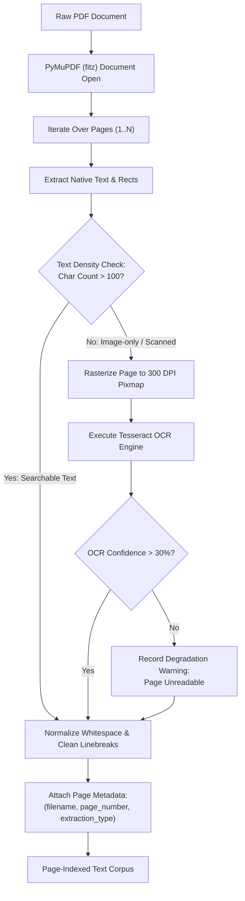
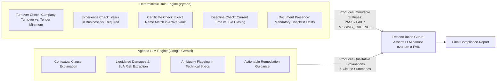
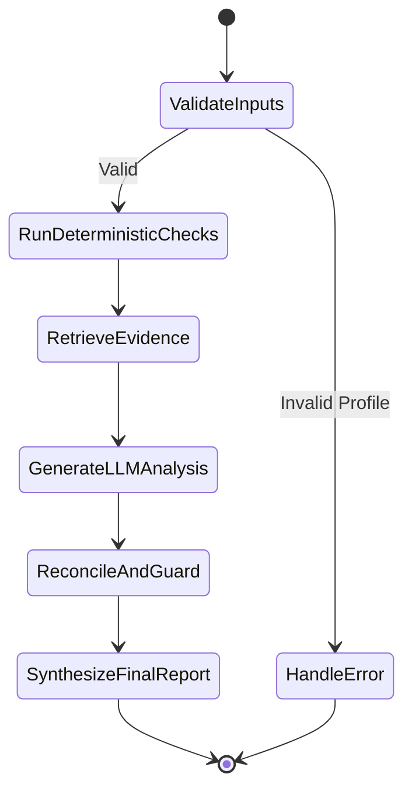

# AI, RAG & Agentic Workflow Architecture

## 1. Document Extraction & OCR Pipeline

Tender notices and RFPs published by public sector organizations vary widely in digital quality, ranging from native, searchable PDFs to scanned raster photocopies of signed tender notices. The document intelligence pipeline ensures robust, lossless text extraction while preserving structural and pagination metadata.



### 1.1 Ingestion Specifications
- **Parser Engine**: PyMuPDF (`fitz`), chosen for its C-level execution speed (sub-millisecond per native page) and robust PDF spec compliance.
- **Scanned Page Detection**: Any page yielding fewer than 100 characters of extractable text is flagged as an image scan.
- **OCR Engine**: Tesseract OCR (via `pytesseract`) configured with page segmentation mode (`--psm 1` or `--psm 3`) and optical character recognition tuned for English alphanumeric legal terms.
- **Pagination Invariance**: The absolute page number from the original physical PDF is permanently attached to each extracted block. Under no circumstances is pagination re-indexed or merged into an untracked string.

---

## 2. Chunking & Metadata Strategy

Standard naive chunking (splitting every $N$ characters without regard for document structure) breaks tender clauses in half, causing retrieval models to miss critical qualifying conditions (e.g., splitting "Must have ISO 9001" from "unless exempted by MSME policy").

### 2.1 Chunking Rules
- **Chunker Algorithm**: Recursive Character Text Splitter with legal and structural boundary delimiters:
  1. `\n\nSection ` / `\n\nClause ` (Clause boundaries)
  2. `\n\n` (Paragraph boundaries)
  3. `\n` (Line breaks)
  4. `. ` (Sentence boundaries)
- **Target Chunk Size**: 600 tokens (~2,400 characters).
- **Chunk Overlap**: 120 tokens (~480 characters) to ensure continuity across clause transitions.
- **Metadata Tuple**: Every chunk stored in the vector database contains:
  ```json
  {
    "tender_id": "660a1f0a1e2b3c4d5e6f7d01",
    "source_file": "NTPC_Switchgear_RFP_Vol1.pdf",
    "page_number": 12,
    "chunk_index": 27,
    "extraction_method": "NATIVE_PYMUPDF",
    "section_hint": "Clause 4.1 Eligibility Criteria"
  }
  ```

---

## 3. Embedding and Vector Storage (ChromaDB)

- **Vector Database**: ChromaDB running in persistent client mode.
- **Tenant & Entity Segregation**: Collections are partitioned or strictly filtered by `tender_id`. Chunks belonging to Tender A are never co-queried with Tender B.
- **Embedding Model**: Google `text-embedding-004` (768 dimensions) or equivalent state-of-the-art dense semantic embedding model.
- **Distance Metric**: Cosine Similarity.
- **Query Strategy**: Hybrid Semantic Search with metadata pre-filtering:
  ```python
  results = collection.query(
      query_texts=[query_str],
      n_results=top_k,
      where={"tender_id": str(tender_id)}
  )
  ```

---

## 4. Separation Between Deterministic Logic & LLM Reasoning

The cardinal architectural rule of the platform is: **The LLM is an explainer and contextual extractor, never an arithmetic or regulatory arbiter.**



### 4.1 Deterministic Evaluation Matrix
| Condition | Deterministic Logic | Output Status |
| :--- | :--- | :--- |
| **Annual Turnover** | `average(company_turnover_last_3_fy) >= tender_min_turnover` | If False: `FAIL`<br>If True: `PASS` |
| **Operational Age** | `(today - company_incorporation_date).years >= tender_min_years` | If False: `FAIL`<br>If True: `PASS` |
| **Mandatory Cert** | `required_cert in company_active_certifications` | If False: `MISSING_EVIDENCE`<br>If True: `PASS` |
| **Vault Document** | `all(doc in company_vault_docs for doc in mandatory_docs)` | If Missing: `MISSING_EVIDENCE`<br>If Present: `PASS` |
| **Tender Deadline** | `utcnow() < tender_submission_deadline` | If False: `FAIL (EXPIRED)`<br>If True: `PASS` |

---

## 5. LangGraph State Machine & Node Architecture

The compliance workflow is implemented as a directed, stateful graph using LangGraph.

### 5.1 State Definition (`ComplianceState`)
```python
from typing import TypedDict, List, Dict, Any, Optional

class ComplianceState(TypedDict):
    tender_id: str
    company_id: str
    tender_metadata: Dict[str, Any]
    company_profile: Dict[str, Any]
    vault_documents: List[Dict[str, Any]]
    
    # Deterministic outputs
    deterministic_results: Dict[str, Any]
    hard_failure_flag: bool
    
    # RAG outputs
    retrieved_chunks: List[Dict[str, Any]]
    
    # AI Synthesis outputs
    llm_analysis: Optional[Dict[str, Any]]
    reconciliation_warnings: List[str]
    
    # Final structured report
    final_report: Optional[Dict[str, Any]]
    error: Optional[str]
```

### 5.2 Node Implementations & Logic Flow



1. **`ValidateInputs` & `LoadContext` Nodes**:
   - Loads company profile, vault documents, and tender structured criteria from PostgreSQL.
   - Computes SHA-256 version fingerprint hashes for both tender criteria and company state.
2. **`ValidateRequirements` & `RunDeterministicChecks` Nodes**:
   - Normalizes raw criteria into typed `NormalizedTenderRequirements`.
   - Executes pure Python rules (`DeterministicRuleEngine`) using `Decimal` arithmetic.
   - Populates criterion-level findings with `PASS`, `FAIL`, `MISSING_EVIDENCE`, `NEEDS_REVIEW`, or `NOT_APPLICABLE`.
3. **`RetrieveEvidence` Node (Hybrid RAG)**:
   - Formulates targeted queries across criteria.
   - Executes hybrid retrieval combining PostgreSQL lexical search and ChromaDB dense embeddings via Reciprocal Rank Fusion ($k=60$).
   - Validates physical page bounds and authorization scope via `CitationValidator`.
4. **`GenerateLLMAnalysis` Node**:
   - Prompts Google Gemini (`gemini-2.5-flash`) with findings, retrieved chunks, and strict grounding instructions.
   - Falls back gracefully to factual deterministic explanations if offline or unconfigured.
5. **`ReconcileAndGuard` Node**:
   - Validates that Gemini did not contradict any deterministic status.
   - If AI explanation attempts to overturn a `FAIL`, the guard strips the override, enforces `FAIL`, and appends an audit alert.
   - Strips unverified citation references from AI text.
6. **`SynthesizeFinalReport` & `PersistReport` Nodes**:
   - Assembles overall status (`ELIGIBLE`, `NOT_ELIGIBLE`, `PARTIALLY_ELIGIBLE`, `NEEDS_REVIEW`), numeric score, and executive recommendations.
   - Persists versioned `ComplianceReport` and relational `ComplianceFinding` records in PostgreSQL.

---

## 6. Citation Strategy, Uncertainty Handling & Hallucination Controls

### 6.1 Strict Grounding System Prompt
```text
SYSTEM INSTRUCTION:
You are an expert Tender Compliance Auditor. You evaluate MSME credentials against tender clauses.
CRITICAL RULES:
1. Every factual assertion you make MUST cite the exact [source_file, Page X] from the provided context.
2. If the provided context does NOT contain information to answer a question or verify a requirement, you MUST output:
   "The available tender documents do not provide information regarding this clause."
3. NEVER fabricate page numbers, clause numbers, or compliance rules.
4. If the deterministic check indicates FAIL or MISSING_EVIDENCE, you must NEVER declare the requirement met.
5. Maintain a neutral, professional, audit-grade tone.
```

### 6.2 Citation Schema
```json
{
  "claim": "Bidder must submit CPRI type test certificates conducted within the last 5 years.",
  "citation": {
    "source_file": "NTPC_Switchgear_RFP_Vol1.pdf",
    "page_number": 19,
    "clause_reference": "Section III, Clause 6.3",
    "verbatim_quote": "Valid CPRI type test certificate for switchgear rating conducted not earlier than 5 years prior to the original bid submission date must be submitted."
  }
}
```

---

## 7. End-to-End Walkthrough Using Fictional Data

### Scenario Setup:
- **Tender**: `NTPC/ELECT/2026/0892` - Procurement of Switchgear Assemblies.
- **Tender Mandatory Rules**:
  - Minimum 3-Year Average Turnover: **INR 35,000,000**
  - Minimum Experience: **5 Years**
  - Mandatory Certifications: **ISO 9001:2015**, **CPRI Type Test Certificate**
- **MSME Profile**: `Precision Tools & Components Pvt Ltd`
  - 3-Year Average Turnover: **INR 53,000,000** (PASS)
  - Years in Business: **11 Years** (PASS)
  - Active Vault Certifications: **ISO 9001:2015** (PASS)
  - CPRI Type Test Certificate: **Not Uploaded** (MISSING_EVIDENCE)

### Execution Trace:
1. `RunDeterministicChecks`:
   - Turnover: $53M \ge 35M \implies \textbf{PASS}$
   - Experience: $11 \text{ yrs} \ge 5 \text{ yrs} \implies \textbf{PASS}$
   - ISO 9001: Found in vault $\implies \textbf{PASS}$
   - CPRI Certificate: Not found in vault $\implies \textbf{MISSING\_EVIDENCE}$
2. `RetrieveEvidence`:
   - Query: `"CPRI type test certificate requirements switchgear"`
   - Result: Retrieved Page 19, Clause 6.3 of `NTPC_Switchgear_RFP_Vol1.pdf`.
3. `GenerateLLMAnalysis`:
   - Gemini produces: *"While Precision Tools easily clears financial turnover and operational tenure thresholds, the bid cannot proceed as-is because the mandatory CPRI Type Test Certificate is missing from the Document Vault. As specified in NTPC_Switchgear_RFP_Vol1.pdf, Page 19, this is a non-waivable technical prerequisite."*
4. `ReconcileAndGuard`:
   - Status confirmed: `POTENTIALLY_ELIGIBLE_WITH_CONDITIONS`.
5. `SynthesizeFinalReport`:
   - Report persisted with action item: *"Upload CPRI Type Test Certificate to Vault prior to bid finalization."*
