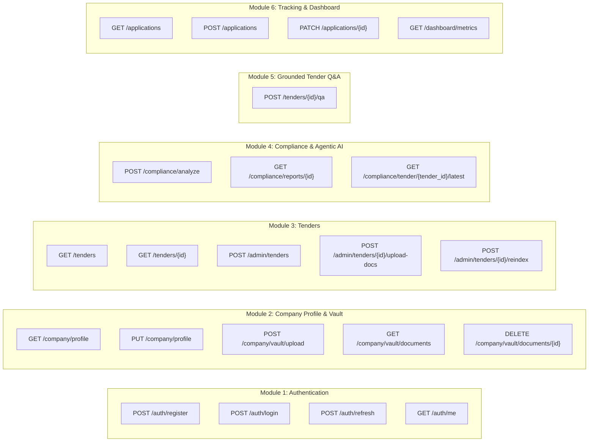

# REST API Specification

## 1. Global API Standards & Conventions

- **Base URL**: `/api/v1`
- **Protocol**: HTTPS / REST
- **Data Exchange Format**: `application/json` (except multipart file upload endpoints: `multipart/form-data`)
- **Authentication**: Bearer Token in HTTP Authorization Header: `Authorization: Bearer <JWT_ACCESS_TOKEN>`
- **Error Format**: RFC 7807 compliant problem details / standardized Pydantic error response:
  ```json
  {
    "success": false,
    "error_code": "RESOURCE_NOT_FOUND",
    "message": "The requested tender could not be found.",
    "details": null,
    "timestamp": "2026-03-20T10:15:30Z"
  }
  ```

---

## 2. API Endpoints by Module



---

## 3. Detailed Endpoint Contracts

### 3.1 Module 1: Authentication & Identity

#### `POST /auth/register`
Creates a new MSME or Admin account.

- **Auth Required**: None (Public)
- **Request Payload**:
  ```json
  {
    "email": "rajesh@precisiontools.in",
    "password": "SecurePassword123!",
    "full_name": "Rajesh Sharma",
    "company_name": "Precision Tools Pvt Ltd",
    "registration_number": "UDYAM-MH-03-0012345"
  }
  ```
- **Response (201 Created)**:
  ```json
  {
    "success": true,
    "message": "Account created successfully.",
    "data": {
      "user_id": "660a1f0a1e2b3c4d5e6f7a01",
      "email": "rajesh@precisiontools.in",
      "role": "MSME_USER",
      "company_id": "660a1f0a1e2b3c4d5e6f7b01"
    }
  }
  ```

#### `POST /auth/login`
Authenticates credentials and returns JWT token pair.

- **Auth Required**: None (Public)
- **Request Payload**:
  ```json
  {
    "email": "rajesh@precisiontools.in",
    "password": "SecurePassword123!"
  }
  ```
- **Response (200 OK)**:
  ```json
  {
    "success": true,
    "data": {
      "access_token": "eyJhbGciOiJIUzI1Ni...",
      "refresh_token": "eyJhbGciOiJIUzI1Ni...",
      "token_type": "bearer",
      "expires_in_seconds": 3600,
      "user": {
        "id": "660a1f0a1e2b3c4d5e6f7a01",
        "email": "rajesh@precisiontools.in",
        "full_name": "Rajesh Sharma",
        "role": "MSME_USER",
        "company_id": "660a1f0a1e2b3c4d5e6f7b01"
      }
    }
  }
  ```

---

### 3.2 Module 2: Company Profile & Document Vault

#### `GET /company/profile`
Retrieves company profile, turnover metrics, and certifications for the authenticated tenant.

- **Auth Required**: Bearer Token (`MSME_USER`)
- **Response (200 OK)**:
  ```json
  {
    "success": true,
    "data": {
      "id": "660a1f0a1e2b3c4d5e6f7b01",
      "legal_name": "Precision Tools Pvt Ltd",
      "registration_number": "UDYAM-MH-03-0012345",
      "business_type": "SMALL",
      "sector": "Industrial Manufacturing",
      "incorporation_date": "2014-06-20",
      "years_in_business": 11,
      "annual_turnover": [
        { "fiscal_year": "2023-2024", "turnover_inr": 48000000.0 },
        { "fiscal_year": "2024-2025", "turnover_inr": 52000000.0 },
        { "fiscal_year": "2025-2026", "turnover_inr": 59000000.0 }
      ],
      "certifications": [
        { "name": "ISO 9001:2015", "valid_until": "2027-12-31" }
      ]
    }
  }
  ```

#### `PUT /company/profile`
Updates financial metrics and company details.

- **Auth Required**: Bearer Token (`MSME_USER`)
- **Request Payload**:
  ```json
  {
    "business_type": "SMALL",
    "sector": "Industrial Manufacturing",
    "incorporation_date": "2014-06-20",
    "annual_turnover": [
      { "fiscal_year": "2023-2024", "turnover_inr": 48000000.0 },
      { "fiscal_year": "2024-2025", "turnover_inr": 52000000.0 },
      { "fiscal_year": "2025-2026", "turnover_inr": 59000000.0 }
    ]
  }
  ```

#### `POST /company/vault/upload`
Uploads a compliance document into the MSME's isolated vault.

- **Auth Required**: Bearer Token (`MSME_USER`)
- **Content-Type**: `multipart/form-data`
- **Form Fields**:
  - `file`: Binary file (`.pdf` only, max 25MB)
  - `document_category`: String enum (`FINANCIAL_AUDIT`, `TAX_RECORD`, `CERTIFICATION`, `WORK_ORDER`)
  - `valid_from`: Date string (optional, `YYYY-MM-DD`)
  - `valid_until`: Date string (optional, `YYYY-MM-DD`)
- **Response (201 Created)**:
  ```json
  {
    "success": true,
    "message": "Document uploaded and verified.",
    "data": {
      "document_id": "660a1f0a1e2b3c4d5e6f7c11",
      "original_filename": "Audited_Balance_Sheet_2025.pdf",
      "document_category": "FINANCIAL_AUDIT",
      "file_size_bytes": 2490120,
      "verification_status": "METADATA_EXTRACTED",
      "uploaded_at": "2026-03-20T11:00:00Z"
    }
  }
  ```

---

### 3.3 Module 3: Tender Management & Ingestion

#### `GET /tenders`
Lists active tenders with filtering and pagination.

- **Auth Required**: Bearer Token (`MSME_USER` or `ADMIN`)
- **Query Parameters**:
  - `sector`: String (optional)
  - `min_budget`: Number (optional)
  - `max_budget`: Number (optional)
  - `search`: String (optional keyword query)
  - `page`: Integer (default: 1)
  - `limit`: Integer (default: 10, max: 50)
- **Response (200 OK)**:
  ```json
  {
    "success": true,
    "data": {
      "items": [
        {
          "id": "660a1f0a1e2b3c4d5e6f7d01",
          "tender_reference": "NTPC/ELECT/2026/0892",
          "title": "Procurement of Heavy-Duty Switchgear Assemblies",
          "issuing_authority": "NTPC",
          "sector": "Electrical Infrastructure",
          "estimated_budget_inr": 45000000.0,
          "emd_amount_inr": 900000.0,
          "msme_emd_exemption": true,
          "submission_deadline": "2026-04-15T15:00:00Z",
          "processing_status": "INDEXED",
          "total_attachments": 2
        }
      ],
      "pagination": {
        "current_page": 1,
        "total_pages": 4,
        "total_items": 38
      }
    }
  }
  ```

#### `POST /admin/tenders`
Creates a new tender record (Admin only).

- **Auth Required**: Bearer Token (`ADMIN`)
- **Request Payload**:
  ```json
  {
    "tender_reference": "NTPC/ELECT/2026/0892",
    "title": "Procurement of Heavy-Duty Switchgear Assemblies",
    "issuing_authority": "National Thermal Power Corporation (NTPC)",
    "sector": "Electrical Infrastructure",
    "estimated_budget_inr": 45000000.0,
    "emd_amount_inr": 900000.0,
    "msme_emd_exemption": true,
    "submission_deadline": "2026-04-15T15:00:00Z",
    "official_portal_url": "https://eprocure.gov.in/app?id=NTPC20260892",
    "structured_requirements": {
      "min_annual_turnover_inr": 35000000.0,
      "min_experience_years": 5,
      "mandatory_certifications": ["ISO 9001:2015"],
      "required_documents": [
        "Audited Balance Sheets (Last 3 FY)",
        "Udyam MSME Registration Certificate"
      ]
    }
  }
  ```

#### `POST /admin/tenders/{id}/upload-docs`
Uploads tender PDF notices and triggers text extraction and ChromaDB vector indexing.

- **Auth Required**: Bearer Token (`ADMIN`)
- **Content-Type**: `multipart/form-data`
- **Form Fields**: `files` (Array of `.pdf` files)
- **Response (202 Accepted)**:
  ```json
  {
    "success": true,
    "message": "Documents accepted. Text extraction and vector indexing initiated in background.",
    "data": {
      "tender_id": "660a1f0a1e2b3c4d5e6f7d01",
      "files_queued": 2,
      "status": "EXTRACTING"
    }
  }
  ```

---

### 3.4 Module 4: Compliance Engine & Agentic AI Analysis

#### `POST /compliance/analyze`
Executes deterministic compliance rules followed by LangGraph agentic RAG analysis.

- **Auth Required**: Bearer Token (`MSME_USER`)
- **Request Payload**:
  ```json
  {
    "tender_id": "660a1f0a1e2b3c4d5e6f7d01"
  }
  ```
- **Response (200 OK)**:
  ```json
  {
    "success": true,
    "data": {
      "report_id": "660a1f0a1e2b3c4d5e6f7e01",
      "company_id": "660a1f0a1e2b3c4d5e6f7b01",
      "tender_id": "660a1f0a1e2b3c4d5e6f7d01",
      "overall_status": "POTENTIALLY_ELIGIBLE_WITH_CONDITIONS",
      "deterministic_summary": {
        "total_checks": 5,
        "passed": 3,
        "failed": 0,
        "needs_review": 1,
        "missing_evidence": 1
      },
      "evaluated_criteria": [
        {
          "criterion_key": "MIN_ANNUAL_TURNOVER",
          "requirement_label": "Minimum Annual Turnover of INR 35,000,000 in last 3 FYs",
          "evaluator": "DETERMINISTIC_ENGINE",
          "status": "PASS",
          "company_value": "Avg INR 53,000,000",
          "threshold_value": "INR 35,000,000",
          "explanation": "Audited turnover meets qualification threshold.",
          "citations": [
            {
              "source_file": "NTPC_Switchgear_RFP_Vol1.pdf",
              "page_number": 12,
              "excerpt": "Clause 4.1.2: Bidder must have average annual financial turnover of at least INR 3.5 Crores."
            }
          ]
        },
        {
          "criterion_key": "MANDATORY_CERT_CPRI",
          "requirement_label": "CPRI Type Test Certificate",
          "evaluator": "DETERMINISTIC_ENGINE",
          "status": "MISSING_EVIDENCE",
          "company_value": null,
          "threshold_value": "CPRI Type Test Certificate required",
          "explanation": "Document not uploaded in Company Vault.",
          "citations": [
            {
              "source_file": "NTPC_Switchgear_RFP_Vol1.pdf",
              "page_number": 19,
              "excerpt": "Clause 6.3: Valid CPRI type test certificate must be submitted."
            }
          ]
        }
      ],
      "missing_evidence": [
        {
          "item": "CPRI Type Test Certificate",
          "remedy": "Upload active credential to Document Vault."
        }
      ],
      "identified_risks": [
        {
          "risk_level": "MEDIUM",
          "clause_topic": "Liquidated Damages",
          "details": "0.5% per week delay penalty capped at 10% total contract value.",
          "page_reference": 34
        }
      ],
      "next_actions": [
        "Upload CPRI Type Test Certificate to Document Vault",
        "Prepare Manufacturer Authorization Form as per Annexure IV"
      ],
      "generated_at": "2026-03-20T11:15:00Z"
    }
  }
  ```

---

### 3.5 Module 5: Grounded Tender Q&A

#### `POST /tenders/{id}/qa`
Answers natural language questions about a tender strictly using ChromaDB RAG and Gemini.

- **Auth Required**: Bearer Token (`MSME_USER` or `ADMIN`)
- **Request Payload**:
  ```json
  {
    "question": "What is the warranty period required for the switchgear assemblies, and what penalty applies to delays?"
  }
  ```
- **Response (200 OK)**:
  ```json
  {
    "success": true,
    "data": {
      "tender_id": "660a1f0a1e2b3c4d5e6f7d01",
      "question": "What is the warranty period required for the switchgear assemblies, and what penalty applies to delays?",
      "answer": "The contractor must warrant the equipment for 36 months from the date of commissioning or 42 months from the date of final delivery, whichever is earlier. Delays in delivery incur liquidated damages of 0.5% of the contract value per week of delay, capped at a maximum of 10% of the total contract value.",
      "citations": [
        {
          "source_file": "NTPC_Switchgear_RFP_Vol1.pdf",
          "page_number": 28,
          "excerpt": "Clause 14.2: The warranty period shall be 36 months from the date of successful commissioning..."
        },
        {
          "source_file": "NTPC_Switchgear_RFP_Vol1.pdf",
          "page_number": 34,
          "excerpt": "Clause 18.1: Liquidated damages for delay in completion will be levied at 0.5% per week subject to a ceiling of 10%..."
        }
      ],
      "confidence_score": 0.94
    }
  }
  ```

---

### 3.6 Module 6: Internal Application Preparation & Tracking

#### `POST /applications`
Initializes or updates internal tracking for preparing a bid.

- **Auth Required**: Bearer Token (`MSME_USER`)
- **Request Payload**:
  ```json
  {
    "tender_id": "660a1f0a1e2b3c4d5e6f7d01",
    "internal_status": "DOCUMENT_GATHERING",
    "assigned_team_member": "Priya Patel",
    "internal_target_date": "2026-04-10T18:00:00Z",
    "notes": "Waiting for supplier quote on CPRI-tested isolator components."
  }
  ```
- **Response (200 OK)**:
  ```json
  {
    "success": true,
    "message": "Application tracker updated.",
    "data": {
      "application_id": "660a1f0a1e2b3c4d5e6f7f01",
      "internal_status": "DOCUMENT_GATHERING",
      "document_checklist_progress": "3/5 items verified"
    }
  }
  ```

---

## 4. Standard HTTP Error Codes

| Status Code | Code Identifier | Description |
| :--- | :--- | :--- |
| **400 Bad Request** | `INVALID_INPUT` | Input failed Pydantic validation (e.g., negative budget, invalid date format). |
| **401 Unauthorized**| `TOKEN_EXPIRED` / `UNAUTHENTICATED` | Missing, malformed, or expired Bearer token. |
| **403 Forbidden**   | `ACCESS_DENIED` | Attempted access to another company's records or admin-only route. |
| **404 Not Found**   | `RESOURCE_NOT_FOUND` | Specified tender, document, or application ID does not exist. |
| **413 Payload Too Large** | `FILE_TOO_LARGE` | Uploaded document exceeds 25MB threshold. |
| **415 Unsupported Media Type** | `INVALID_FILE_TYPE` | Uploaded file MIME is not `application/pdf`. |
| **422 Unprocessable**| `DOCUMENT_CORRUPT` | PDF file cannot be parsed or opened by PyMuPDF. |
| **503 Service Unavailable** | `AI_SERVICE_UNAVAILABLE` | Google Gemini API timeout or rate limit exceeded after retries. |
