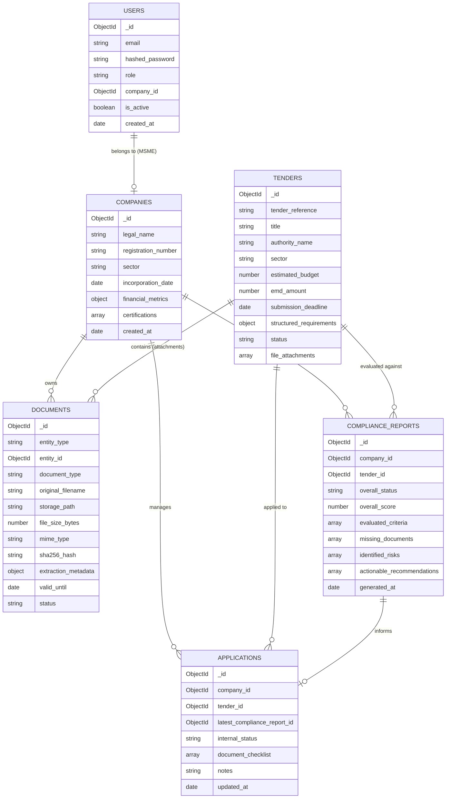

# Database Schema Specification

> [!IMPORTANT]
> **Architectural Update (Phase 2)**: Per the approved technical baseline, **PostgreSQL** is the final primary application datastore, replacing MongoDB. Data models are implemented as normalized relational tables with UUID primary keys using SQLAlchemy 2.x and Alembic migrations. ChromaDB remains the dedicated vector store for RAG in later phases. The original document concepts below have been mapped directly to relational tables (`users`, `companies`, `documents`, etc.).

## 1. Overview and Design Principles

The platform utilizes **MongoDB** as its primary operational and document datastore. MongoDB's flexible BSON document model is particularly well-suited for tender management, which involves semi-structured legal requirements, nested company credentials, multi-file attachments, and dynamic compliance reports.

### Key Data Architecture Principles:
1. **Tenant Isolation**: Every tenant-owned record (`documents`, `compliance_reports`, `applications`, `company_profiles`) contains an indexed `company_id` referencing the owning company. Queries executed on behalf of MSME users enforce this filter at the data access layer.
2. **Deterministic & Audit History**: Compliance reports and application snapshots are treated as immutable point-in-time evaluation records to preserve auditability even if company profiles or tender criteria change later.
3. **Document Versioning**: Company documents support version increments and validity tracking (`valid_from`, `valid_until`, `is_current`).
4. **Referential Integrity**: While MongoDB does not enforce foreign keys at the engine level, referential consistency is enforced via Pydantic model validations and application-level repository constraints.

---

## 2. Entity-Relationship Overview



---

## 3. Detailed Collection Specifications

### 3.1 Collection: `users`
Stores user identities, credentials, and role assignments.

| Field Name | Type | Constraints / Description |
| :--- | :--- | :--- |
| `_id` | `ObjectId` | Primary Key |
| `email` | `String` | Unique, lowercase, indexed |
| `hashed_password` | `String` | bcrypt-hashed password hash |
| `full_name` | `String` | User display name |
| `role` | `String` | Enum: `ADMIN`, `MSME_USER` |
| `company_id` | `ObjectId` | Nullable (null for `ADMIN`, required for `MSME_USER`) |
| `is_active` | `Boolean` | Account status flag (default: `true`) |
| `created_at` | `DateTime` | UTC timestamp of registration |
| `updated_at` | `DateTime` | UTC timestamp of last update |

#### Fictional Example:
```json
{
  "_id": { "$oid": "660a1f0a1e2b3c4d5e6f7a01" },
  "email": "rajesh@precisiontools.in",
  "hashed_password": "$2b$12$e8Y...fX3O1L",
  "full_name": "Rajesh Sharma",
  "role": "MSME_USER",
  "company_id": { "$oid": "660a1f0a1e2b3c4d5e6f7b01" },
  "is_active": true,
  "created_at": { "$date": "2026-03-15T09:30:00Z" },
  "updated_at": { "$date": "2026-03-15T09:30:00Z" }
}
```

---

### 3.2 Collection: `companies`
Stores business profile credentials, audited financials, and operational details used for deterministic eligibility checks.

| Field Name | Type | Constraints / Description |
| :--- | :--- | :--- |
| `_id` | `ObjectId` | Primary Key |
| `legal_name` | `String` | Registered corporate name |
| `registration_number` | `String` | Unique tax/business ID (e.g., Udyam / GSTIN) |
| `business_type` | `String` | Enum: `MICRO`, `SMALL`, `MEDIUM`, `ENTERPRISE` |
| `sector` | `String` | Primary operational sector (e.g., "Manufacturing", "IT Services") |
| `incorporation_date` | `DateTime` | Used to compute years in business deterministically |
| `annual_turnover` | `Array[Object]` | Last 3-5 fiscal years turnover (FY, amount, currency) |
| `certifications` | `Array[Object]` | Active credentials (name, issuing_body, valid_until) |
| `work_experience` | `Array[Object]` | Past completed projects (title, client, value, completion_date) |
| `created_at` | `DateTime` | Profile creation timestamp |
| `updated_at` | `DateTime` | Last profile update timestamp |

#### Fictional Example:
```json
{
  "_id": { "$oid": "660a1f0a1e2b3c4d5e6f7b01" },
  "legal_name": "Precision Tools & Components Pvt Ltd",
  "registration_number": "UDYAM-MH-03-0012345",
  "business_type": "SMALL",
  "sector": "Industrial Manufacturing",
  "incorporation_date": { "$date": "2014-06-20T00:00:00Z" },
  "annual_turnover": [
    { "fiscal_year": "2023-2024", "turnover_inr": 48000000.0, "currency": "INR" },
    { "fiscal_year": "2024-2025", "turnover_inr": 52000000.0, "currency": "INR" },
    { "fiscal_year": "2025-2026", "turnover_inr": 59000000.0, "currency": "INR" }
  ],
  "certifications": [
    {
      "name": "ISO 9001:2015",
      "issuing_authority": "TUV Nord",
      "valid_until": { "$date": "2027-12-31T00:00:00Z" },
      "document_id": { "$oid": "660a1f0a1e2b3c4d5e6f7c11" }
    }
  ],
  "work_experience": [
    {
      "project_title": "Supply of CNC Milled Valves to Thermal Plant",
      "client_name": "Maharashtra State Power Corp",
      "contract_value_inr": 18500000.0,
      "completion_date": { "$date": "2025-01-15T00:00:00Z" }
    }
  ],
  "created_at": { "$date": "2026-03-15T09:35:00Z" },
  "updated_at": { "$date": "2026-03-16T11:20:00Z" }
}
```

---

### 3.3 Collection: `tenders`
Stores tender opportunities, structured eligibility thresholds, document links, and indexing states.

| Field Name | Type | Constraints / Description |
| :--- | :--- | :--- |
| `_id` | `ObjectId` | Primary Key |
| `tender_reference` | `String` | Official tender reference code (unique, indexed) |
| `title` | `String` | Official tender title |
| `issuing_authority` | `String` | Government department or public sector enterprise |
| `sector` | `String` | Procurement domain classification |
| `estimated_budget_inr`| `Number` | Estimated tender contract value |
| `emd_amount_inr` | `Number` | Earnest Money Deposit required |
| `msme_emd_exemption` | `Boolean` | True if MSMEs are legally exempt from EMD |
| `publication_date` | `DateTime` | Tender notice release date |
| `submission_deadline`| `DateTime` | Hard bid closing timestamp (UTC) |
| `official_portal_url`| `String` | Source URL for external portal verification |
| `structured_requirements`| `Object` | Deterministic criteria thresholds (min turnover, min experience, certs) |
| `processing_status` | `String` | Enum: `PENDING`, `EXTRACTING`, `INDEXED`, `FAILED` |
| `file_attachments` | `Array[Object]` | Attached PDF notices and RFPs |
| `created_by` | `ObjectId` | Reference to `users._id` (Admin user) |
| `created_at` | `DateTime` | Ingestion timestamp |

#### Fictional Example:
```json
{
  "_id": { "$oid": "660a1f0a1e2b3c4d5e6f7d01" },
  "tender_reference": "NTPC/ELECT/2026/0892",
  "title": "Procurement of Heavy-Duty Switchgear Assemblies for Solar Substation",
  "issuing_authority": "National Thermal Power Corporation (NTPC)",
  "sector": "Electrical Infrastructure",
  "estimated_budget_inr": 45000000.0,
  "emd_amount_inr": 900000.0,
  "msme_emd_exemption": true,
  "publication_date": { "$date": "2026-03-01T10:00:00Z" },
  "submission_deadline": { "$date": "2026-04-15T15:00:00Z" },
  "official_portal_url": "https://eprocure.gov.in/eprocure/app?id=NTPC20260892",
  "structured_requirements": {
    "min_annual_turnover_inr": 35000000.0,
    "min_experience_years": 5,
    "mandatory_certifications": ["ISO 9001:2015", "CPRI Type Test Certificate"],
    "required_documents": [
      "Audited Balance Sheets (Last 3 FY)",
      "Udyam MSME Registration Certificate",
      "GST Return Filing Proof (Latest Qtr)",
      "CPRI Type Test Certification"
    ]
  },
  "processing_status": "INDEXED",
  "file_attachments": [
    {
      "filename": "NTPC_Switchgear_RFP_Vol1.pdf",
      "file_path": "uploads/tenders/660a1f0a1e2b3c4d5e6f7d01/NTPC_Switchgear_RFP_Vol1.pdf",
      "total_pages": 48,
      "ocr_applied_pages": [1, 2],
      "indexed_chunks": 114
    }
  ],
  "created_by": { "$oid": "660a1f0a1e2b3c4d5e6f7a00" },
  "created_at": { "$date": "2026-03-02T14:00:00Z" }
}
```

---

### 3.4 Collection: `documents`
Metadata registry for all binary files stored in the local file storage (both MSME vault documents and tender RFP PDFs).

| Field Name | Type | Constraints / Description |
| :--- | :--- | :--- |
| `_id` | `ObjectId` | Primary Key |
| `owner_type` | `String` | Enum: `COMPANY_VAULT`, `TENDER_ATTACHMENT` |
| `owner_id` | `ObjectId` | References `companies._id` or `tenders._id` |
| `document_category`| `String` | Enum: `FINANCIAL_AUDIT`, `TAX_RECORD`, `CERTIFICATION`, `WORK_ORDER`, `TENDER_RFP` |
| `original_filename`| `String` | User-provided filename |
| `storage_path` | `String` | Relative disk storage path |
| `mime_type` | `String` | Validated MIME type (e.g., `application/pdf`) |
| `file_size_bytes` | `Number` | Size in bytes |
| `sha256_hash` | `String` | File content hash for deduplication |
| `valid_from` | `DateTime` | Validity start timestamp (nullable) |
| `valid_until` | `DateTime` | Expiration timestamp (nullable) |
| `verification_status`| `String` | Enum: `UNVERIFIED`, `METADATA_EXTRACTED`, `VERIFIED_VALID`, `EXPIRED` |
| `created_at` | `DateTime` | Upload timestamp |

#### Fictional Example:
```json
{
  "_id": { "$oid": "660a1f0a1e2b3c4d5e6f7c11" },
  "owner_type": "COMPANY_VAULT",
  "owner_id": { "$oid": "660a1f0a1e2b3c4d5e6f7b01" },
  "document_category": "CERTIFICATION",
  "original_filename": "TUV_ISO_9001_Certificate_2024.pdf",
  "storage_path": "uploads/vault/660a1f0a1e2b3c4d5e6f7b01/TUV_ISO_9001_Certificate_2024.pdf",
  "mime_type": "application/pdf",
  "file_size_bytes": 1420550,
  "sha256_hash": "e3b0c44298fc1c149afbf4c8996fb92427ae41e4649b934ca495991b7852b855",
  "valid_from": { "$date": "2024-01-01T00:00:00Z" },
  "valid_until": { "$date": "2027-12-31T23:59:59Z" },
  "verification_status": "VERIFIED_VALID",
  "created_at": { "$date": "2026-03-15T10:00:00Z" }
}
```

---

### 3.5 Collection: `compliance_reports`
Stores immutable, point-in-time compliance evaluation outputs generated by the LangGraph engine.

| Field Name | Type | Constraints / Description |
| :--- | :--- | :--- |
| `_id` | `ObjectId` | Primary Key |
| `company_id` | `ObjectId` | References `companies._id` (indexed) |
| `tender_id` | `ObjectId` | References `tenders._id` (indexed) |
| `overall_status` | `String` | Enum: `ELIGIBLE`, `INELIGIBLE`, `POTENTIALLY_ELIGIBLE_WITH_CONDITIONS` |
| `deterministic_summary` | `Object` | Breakdown of hard checks (pass_count, fail_count, missing_count) |
| `evaluated_criteria` | `Array[Object]` | Detailed list of evaluated items (name, rule, result, evidence, citations) |
| `missing_evidence` | `Array[Object]` | Missing documents and unverified prerequisites |
| `identified_risks` | `Array[Object]` | AI-extracted risks (liquidated damages, strict SLAs, bank guarantee terms) |
| `next_actions` | `Array[String]` | Prescribed steps to prepare bid |
| `generated_at` | `DateTime` | Generation timestamp |

#### Fictional Example:
```json
{
  "_id": { "$oid": "660a1f0a1e2b3c4d5e6f7e01" },
  "company_id": { "$oid": "660a1f0a1e2b3c4d5e6f7b01" },
  "tender_id": { "$oid": "660a1f0a1e2b3c4d5e6f7d01" },
  "overall_status": "POTENTIALLY_ELIGIBLE_WITH_CONDITIONS",
  "deterministic_summary": {
    "total_checks": 5,
    "passed": 3,
    "failed": 0,
    "needs_review": 1,
    "missing_evidence": 1
  },
  "evaluated_criteria": [
    {
      "criterion_key": "MIN_ANNUAL_TURNOVER",
      "requirement_label": "Minimum Annual Turnover of INR 35,000,000 in last 3 FYs",
      "evaluator": "DETERMINISTIC_ENGINE",
      "status": "PASS",
      "company_value": "Avg INR 53,000,000",
      "threshold_value": "INR 35,000,000",
      "explanation": "Company audited turnover exceeds minimum requirement by 51.4%.",
      "citations": [
        {
          "source_file": "NTPC_Switchgear_RFP_Vol1.pdf",
          "page_number": 12,
          "excerpt": "Clause 4.1.2: Bidder must have average annual financial turnover of at least INR 3.5 Crores."
        }
      ]
    },
    {
      "criterion_key": "MANDATORY_CERT_CPRI",
      "requirement_label": "Valid CPRI Type Test Certificate",
      "evaluator": "DETERMINISTIC_ENGINE",
      "status": "MISSING_EVIDENCE",
      "company_value": null,
      "threshold_value": "CPRI Type Test Certificate required",
      "explanation": "No CPRI Type Test Certificate was found in Company Document Vault.",
      "citations": [
        {
          "source_file": "NTPC_Switchgear_RFP_Vol1.pdf",
          "page_number": 19,
          "excerpt": "Clause 6.3: Valid CPRI type test certificate for switchgear rating must be submitted."
        }
      ]
    }
  ],
  "missing_evidence": [
    {
      "item": "CPRI Type Test Certificate",
      "remedy": "Obtain certificate from laboratory or upload active credential to Vault."
    }
  ],
  "identified_risks": [
    {
      "risk_level": "MEDIUM",
      "clause_topic": "Liquidated Damages",
      "details": "0.5% per week delay penalty capped at 10% total contract value.",
      "page_reference": 34
    }
  ],
  "next_actions": [
    "Upload CPRI Type Test Certificate to Document Vault",
    "Prepare Manufacturer Authorization Form as per Annexure IV",
    "Review Liquidated Damages clause with delivery engineering team"
  ],
  "generated_at": { "$date": "2026-03-18T14:22:10Z" }
}
```

---

### 3.6 Collection: `applications`
Tracks internal preparation workflows, document assembly, and readiness states for a specific tender bid.

| Field Name | Type | Constraints / Description |
| :--- | :--- | :--- |
| `_id` | `ObjectId` | Primary Key |
| `company_id` | `ObjectId` | Owning MSME (indexed) |
| `tender_id` | `ObjectId` | Target tender (indexed) |
| `compliance_report_id` | `ObjectId` | Associated compliance report |
| `internal_status` | `String` | Enum: `UNDER_EVALUATION`, `DOCUMENT_GATHERING`, `INTERNAL_REVIEW`, `READY_FOR_PORTAL_SUBMISSION`, `SUBMITTED_EXTERNALLY`, `ARCHIVED` |
| `document_checklist` | `Array[Object]` | Itemized readiness checklist (item, status, document_id) |
| `assigned_team_member`| `String` | Internal person responsible |
| `internal_target_date`| `DateTime` | MSME internal target cutoff before actual submission deadline |
| `submission_notes` | `String` | Free-form operational notes |
| `created_at` | `DateTime` | Creation timestamp |
| `updated_at` | `DateTime` | Last update timestamp |

---

## 4. Database Indexing Strategy

To guarantee query performance, uniqueness, and strict multi-tenant filtering, the following compound and single-field indexes are specified:

```javascript
// 1. Users Collection
db.users.createIndex({ "email": 1 }, { unique: true });
db.users.createIndex({ "company_id": 1 });

// 2. Companies Collection
db.companies.createIndex({ "registration_number": 1 }, { unique: true });
db.companies.createIndex({ "sector": 1 });

// 3. Tenders Collection
db.tenders.createIndex({ "tender_reference": 1 }, { unique: true });
db.tenders.createIndex({ "submission_deadline": 1 });
db.tenders.createIndex({ "sector": 1, "processing_status": 1 });
db.tenders.createIndex({ "title": "text", "issuing_authority": "text" });

// 4. Documents Collection
db.documents.createIndex({ "owner_type": 1, "owner_id": 1 });
db.documents.createIndex({ "sha256_hash": 1, "owner_id": 1 }, { unique: true }); // Deduplication per owner

// 5. Compliance Reports Collection
db.compliance_reports.createIndex({ "company_id": 1, "tender_id": 1, "generated_at": -1 });

// 6. Applications Collection
db.applications.createIndex({ "company_id": 1, "tender_id": 1 }, { unique: true }); // One application record per tender
db.applications.createIndex({ "company_id": 1, "internal_status": 1 });
```

---

## 5. Document Deduplication, Versioning & Retention

1. **SHA-256 Deduplication**: Prior to writing an uploaded file to disk or recording it in the `documents` collection, its SHA-256 hash is computed. If an identical hash exists for the same `company_id`, the system references the existing document rather than creating redundant disk duplicates.
2. **Document Versioning**: When an updated version of a document (e.g., renewed ISO certificate) is uploaded, the existing document status is updated to `SUPERSEDED`, and a new active document record is created with `valid_from` and `valid_until` timestamps.
3. **Audit Trail Retention**: Compliance reports and completed application states are immutable. They capture point-in-time snapshots of evaluated financial and technical credentials to ensure complete audit reproducibility even if company metrics are updated for subsequent tenders.

---

## 6. Phase 4 Relational Schema (PostgreSQL Implementation)

Per Alembic revision `ef93ccad0bf2`, the following tables implement the Phase 4 deterministic compliance engine, hybrid retrieval layer, and audit-grade report persistence:

### 6.1 `document_chunks`
Stores textual document excerpts enabling PostgreSQL lexical search and exact citation provenance:
| Column | Type | Constraints / Defaults | Description |
| :--- | :--- | :--- | :--- |
| `id` | `VARCHAR(128)` | `PRIMARY KEY` | Stable deterministic chunk identifier (`{doc_id}_{chunk_index}`) |
| `document_id` | `UUID` | `FOREIGN KEY (documents.id) ON DELETE CASCADE`, `INDEX` | Owning document record |
| `tender_id` | `UUID` | `FOREIGN KEY (tenders.id) ON DELETE CASCADE`, `INDEX`, `NULLABLE` | Scoped public tender notice |
| `company_id` | `UUID` | `FOREIGN KEY (companies.id) ON DELETE CASCADE`, `INDEX`, `NULLABLE` | Scoped MSME corporate vault |
| `source_filename`| `VARCHAR(255)` | `NOT NULL` | Authoritative original filename |
| `page_number` | `INTEGER` | `NOT NULL` | 1-based physical page provenance |
| `chunk_index` | `INTEGER` | `NOT NULL` | Sequential position within document |
| `char_start` | `INTEGER` | `NOT NULL` | Start character index in extracted page |
| `char_end` | `INTEGER` | `NOT NULL` | End character index in extracted page |
| `sha256_hash` | `VARCHAR(64)` | `NOT NULL` | SHA-256 hash of raw extracted chunk text |
| `chunk_text` | `TEXT` | `NOT NULL` | Cleaned textual content |
| `extraction_method` | `VARCHAR(50)` | `NOT NULL`, `DEFAULT 'pymupdf_direct'` | Extraction engine (`pymupdf_direct` or `tesseract_ocr`) |
| `created_at` | `TIMESTAMP WITH TIME ZONE` | `NOT NULL`, `DEFAULT now()` | Creation timestamp |

### 6.2 `compliance_reports`
Stores immutable, point-in-time evaluation snapshots with cryptographic version tracking:
| Column | Type | Constraints / Defaults | Description |
| :--- | :--- | :--- | :--- |
| `id` | `UUID` | `PRIMARY KEY`, `DEFAULT gen_random_uuid()` | Unique report identifier |
| `tender_id` | `UUID` | `FOREIGN KEY (tenders.id) ON DELETE CASCADE`, `INDEX` | Target tender notice |
| `company_id` | `UUID` | `FOREIGN KEY (companies.id) ON DELETE CASCADE`, `INDEX` | Evaluated MSME company |
| `generated_by` | `UUID` | `FOREIGN KEY (users.id) ON DELETE SET NULL`, `INDEX`, `NULLABLE` | Authenticated user triggering evaluation |
| `overall_status` | `VARCHAR(50)` | `NOT NULL`, `INDEX` | `ELIGIBLE`, `NOT_ELIGIBLE`, `PARTIALLY_ELIGIBLE`, `NEEDS_REVIEW` |
| `overall_score` | `NUMERIC(5, 2)` | `NOT NULL`, `DEFAULT 0.00` | Percentage score (0.00% to 100.00%) |
| `summary` | `TEXT` | `NOT NULL` | Comprehensive decision summary with audit trail |
| `rule_engine_version` | `VARCHAR(50)` | `NOT NULL`, `DEFAULT '1.0.0'` | Deterministic rule engine release version |
| `tender_version_hash` | `VARCHAR(64)` | `NOT NULL` | SHA-256 fingerprint of evaluated tender criteria |
| `company_version_hash` | `VARCHAR(64)` | `NOT NULL` | SHA-256 fingerprint of company profile & vault state |
| `processing_metadata` | `JSONB` | `DEFAULT '{}'` | Diagnostic counters, retrieval status, reconciliation alerts |
| `created_at` | `TIMESTAMP WITH TIME ZONE` | `NOT NULL`, `DEFAULT now()` | Generation timestamp |
| `updated_at` | `TIMESTAMP WITH TIME ZONE` | `NOT NULL`, `DEFAULT now()` | Last update timestamp |

### 6.3 `compliance_findings`
Stores granular, individual criterion evaluations with page-level citations:
| Column | Type | Constraints / Defaults | Description |
| :--- | :--- | :--- | :--- |
| `id` | `UUID` | `PRIMARY KEY`, `DEFAULT gen_random_uuid()` | Unique finding identifier |
| `report_id` | `UUID` | `FOREIGN KEY (compliance_reports.id) ON DELETE CASCADE`, `INDEX` | Parent compliance report |
| `requirement_id` | `VARCHAR(100)` | `NOT NULL`, `INDEX` | Unique criterion ID (e.g. `CRIT_TURNOVER_01`) |
| `rule_type` | `VARCHAR(50)` | `NOT NULL`, `INDEX` | `TURNOVER`, `EXPERIENCE`, `CERTIFICATION`, `MANDATORY_DOCUMENT`, `DEADLINE`, `OTHER` |
| `requirement_description` | `TEXT` | `NOT NULL` | Human-readable requirement specification |
| `required_value` | `JSONB` | `NULLABLE` | Normalized threshold criteria dictionary |
| `observed_value` | `JSONB` | `NULLABLE` | Company credential metrics verified by engine |
| `status` | `VARCHAR(50)` | `NOT NULL`, `INDEX` | `PASS`, `FAIL`, `MISSING_EVIDENCE`, `NEEDS_REVIEW`, `NOT_APPLICABLE` |
| `is_mandatory` | `BOOLEAN` | `NOT NULL`, `DEFAULT true` | If true, failure causes `NOT_ELIGIBLE` |
| `reason` | `TEXT` | `NOT NULL` | Deterministic mathematical or factual rationale |
| `ai_explanation` | `TEXT` | `NULLABLE` | Explainable natural language analysis by Gemini |
| `evidence_citations` | `JSONB` | `NOT NULL`, `DEFAULT '[]'` | Array of verified `EvidenceCitation` schemas with page provenance |
| `created_at` | `TIMESTAMP WITH TIME ZONE` | `NOT NULL`, `DEFAULT now()` | Creation timestamp |

