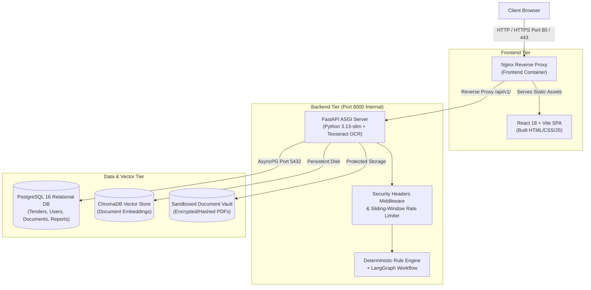

# Production & Development Deployment Guide

**Agentic AI-Powered Tender Intelligence and Compliance Management Platform for MSMEs Using RAG**

---

## 1. System Architecture Overview

The platform is designed as a secure, containerized multi-tier web application consisting of:



---

## 2. Production Deployment via Docker Compose

### Prerequisites
- Docker Engine 24.0+ and Docker Compose v2.20+
- Host system: Linux (Ubuntu 22.04 LTS recommended) or Windows Server with WSL2
- At least 4 CPU cores and 8GB RAM (recommended for embedding and OCR execution)

### 2.1 Configuration
1. Clone the repository to the production server:
   ```bash
   git clone <repository_url> tender_platform
   cd tender_platform
   ```

2. Create production backend environment configuration in `backend/.env`:
   ```env
   PROJECT_NAME="Tender Intelligence and Compliance Platform"
   API_V1_STR=/api/v1
   ENVIRONMENT=production
   DEBUG=False

   # Database
   POSTGRES_SERVER=postgres
   POSTGRES_PORT=5432
   POSTGRES_USER=tender_user
   POSTGRES_PASSWORD=<STRONG_RANDOM_POSTGRES_PASSWORD>
   POSTGRES_DB=tender_platform
   DATABASE_URL=postgresql+asyncpg://tender_user:<STRONG_RANDOM_POSTGRES_PASSWORD>@postgres:5432/tender_platform

   # Security
   SECRET_KEY=<CRYPTOGRAPHICALLY_SECURE_64_CHAR_HEX_SECRET>
   ALGORITHM=HS256
   ACCESS_TOKEN_EXPIRE_MINUTES=60
   REFRESH_TOKEN_EXPIRE_DAYS=7

   # AI & Embeddings
   GEMINI_API_KEY=<VALID_GOOGLE_GEMINI_API_KEY>
   GEMINI_MODEL=gemini-2.5-flash
   CHROMA_PERSIST_DIRECTORY=/app/data/chroma
   UPLOAD_BASE_DIR=/app/uploads

   # Limits
   MAX_UPLOAD_SIZE_BYTES=26214400
   ALLOWED_UPLOAD_EXTENSIONS=.pdf
   ```

### 2.2 Launching Production Containers
Run the production Compose stack in detached mode:
```bash
docker compose -f docker-compose.prod.yml up -d --build
```

### 2.3 Applying Database Migrations
Once the `postgres` service is healthy, apply the Alembic migration head:
```bash
docker compose -f docker-compose.prod.yml exec backend .venv/bin/alembic upgrade head
```

### 2.4 Verifying Service Health
Check running container states:
```bash
docker compose -f docker-compose.prod.yml ps
```
Expected output:
- `tender_bid_postgres_prod`: `Up (healthy)`
- `tender_bid_backend_prod`: `Up (healthy)`
- `tender_bid_frontend_prod`: `Up`

Test the readiness endpoint:
```bash
curl -I http://localhost/api/v1/health/ready
```
Expected response: `HTTP/1.1 200 OK`

---

## 3. Local Development Deployment (Windows Native)

For local development without Docker, use the following procedure:

### Prerequisites
- Python 3.13 (64-bit)
- Node.js 20+ (v24 LTS confirmed working) and npm 10+
- PostgreSQL 16 (running locally or via `docker compose up -d postgres`)
- Tesseract OCR (installed and added to system `PATH` or configured via `TESSERACT_CMD`)

### 3.1 Database Setup
Start the local PostgreSQL container:
```powershell
docker compose up -d postgres
```
The database will be accessible on `localhost:5433`.

### 3.2 Backend Setup
```powershell
cd backend
python -m venv .venv
.\.venv\Scripts\Activate.ps1
pip install -r requirements.txt

# Apply migrations
.\.venv\Scripts\python.exe -m alembic upgrade head

# Run backend test suite
.\.venv\Scripts\python.exe -m pytest -v

# Start FastAPI development server
.\.venv\Scripts\python.exe -m uvicorn app.main:app --host 127.0.0.1 --port 8000 --reload
```

### 3.3 Frontend Setup
```powershell
cd frontend
npm install

# Run frontend tests
npm test -- --run

# Start Vite dev server with proxy to backend
npm run dev
```
The frontend interface is accessible at `http://localhost:5173`.

---

## 4. Container Specifications & Security Controls

### 4.1 Backend Dockerfile (`backend/Dockerfile`)
- **Base Image**: `python:3.13-slim`
- **System Dependencies**: `tesseract-ocr`, `tesseract-ocr-eng`, `libgl1`, `curl`
- **Security**: Runs under non-root unprivileged user `appuser` (UID 10001)
- **Healthcheck Probe**: Probes `/api/v1/health/ready` every 30s with 5s timeout and 3 retries
- **Storage Volumes**: `/app/uploads` and `/app/data/chroma`

### 4.2 Frontend Dockerfile (`frontend/Dockerfile`)
- **Stage 1 (Builder)**: `node:20-alpine` runs `npm ci` and `npm run build`
- **Stage 2 (Runtime)**: `nginx:alpine` copies compiled static assets from builder stage
- **Reverse Proxy**: Proxies `/api/v1/` transparently to `http://backend:8000/api/v1/`
- **SPA Fallback**: Configured with `try_files $uri $uri/ /index.html` to support client-side React routing
- **HTTP Compression**: Gzip enabled for HTML, CSS, JS, and JSON payloads

### 4.3 Production Compose Configuration (`docker-compose.prod.yml`)
- **Network Isolation**: All services communicate across an internal private bridge network `tender_prod_network`
- **Port Exposure**: Only HTTP port 80 (or HTTPS 443 via host reverse proxy) is bound to the public host interface; database and backend ports are restricted to internal container networking
- **Data Persistence**: Named Docker volumes maintain state across restarts:
  - `postgres_prod_data`: Relational schemas, audit trails, user accounts
  - `backend_prod_uploads`: Uploaded RFP documents and MSME vault PDFs
  - `chroma_prod_data`: Persistent vector embeddings and HNSW graph indexes

---

## 5. Security & Operational Hardening Checklist

| Domain | Control | Implementation | Verification |
| :--- | :--- | :--- | :--- |
| **Headers** | Content Type Options | `X-Content-Type-Options: nosniff` | `curl -I http://localhost/api/v1/health` |
| **Headers** | Frame Guard | `X-Frame-Options: DENY` | Clickjacking prevention test |
| **Headers** | Cross-Site Scripting | `X-XSS-Protection: 1; mode=block` | Verified in response headers |
| **Headers** | Referrer Policy | `strict-origin-when-cross-origin` | Verified in response headers |
| **Rate Limit**| Auth Endpoints | 60 requests/minute per client IP | Returns `429 Too Many Requests` |
| **Rate Limit**| Analysis Endpoints | 30 requests/minute per client IP | Returns `429` with `Retry-After` header |
| **File Guard**| Magic Bytes Check | First 4 bytes must match `%PDF-` | Rejects renamed non-PDF files |
| **File Guard**| Max Payload Limit | 25MB hard ceiling per upload | Returns `413 Payload Too Large` |
| **File Guard**| Path Traversal | Filenames mapped to UUIDs on disk | Traversal characters stripped |
| **Secrets** | Zero Hardcoded Keys | Environment variables only | Confirmed by automated secret scan |
| **Database** | Migration History | Alembic head tracking | Version table: `alembic_version` |

---

## 6. Backup and Recovery Runbook

### Relational Database Backup
```bash
docker compose -f docker-compose.prod.yml exec -T postgres pg_dump -U tender_user tender_platform > backup_tender_$(date +%Y%m%d_%H%M%S).sql
```

### Relational Database Restore
```bash
cat backup_tender_<timestamp>.sql | docker compose -f docker-compose.prod.yml exec -T postgres psql -U tender_user -d tender_platform
```

### Document Vault & Vector Store Backup
```bash
docker run --rm -v tender_platform_backend_prod_uploads:/data -v $(pwd):/backup alpine tar czf /backup/vault_backup_$(date +%Y%m%d).tar.gz -C /data .
docker run --rm -v tender_platform_chroma_prod_data:/data -v $(pwd):/backup alpine tar czf /backup/chroma_backup_$(date +%Y%m%d).tar.gz -C /data .
```
