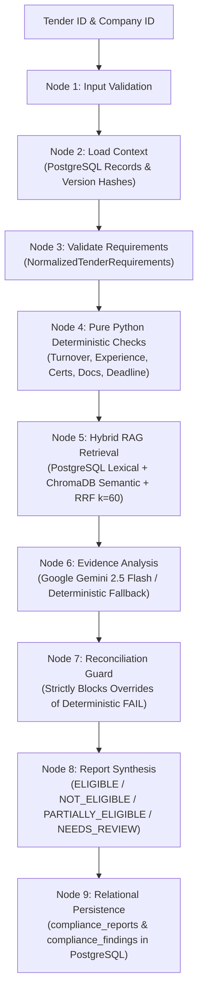

# PHASE 4 IMPLEMENTATION REPORT: Deterministic Compliance Engine, Hybrid RAG Retrieval, LangGraph Orchestration & Gemini Analysis

**Project Title**: Agentic AI-Powered Tender Intelligence and Compliance Management Platform for MSMEs Using RAG  
**Environment**: Windows 11, Python 3.13.15, PostgreSQL 16 (Docker container on port 5433), ChromaDB, LangGraph 1.2.16, Google GenAI SDK 2.32.0  
**Date**: October 21, 2026  
**Status**: COMPLETE (65/65 Automated Tests Passing — 100% Green)

---

## 1. Executive Summary

Phase 4 delivers the core intelligence capability of the platform: an explainable, audit-grade compliance management engine that evaluates Micro, Small, and Medium Enterprises (MSMEs) against complex public procurement tenders.

The non-negotiable architectural principle has been strictly implemented and verified:
> **Pure Python rules determine objective eligibility results, Hybrid RAG retrieves verifiable document evidence with page-level provenance, and Google Gemini explains findings without being allowed to override a deterministic failure or fabricate evidence.**

### Key Highlights
- **100% Deterministic Financial Arithmetic**: Turnover evaluated with exact `Decimal` arithmetic.
- **Experience Integrity**: Validates domain-specific project experience; strictly prevents substituting company incorporation age for domain project experience.
- **Hybrid RAG Retrieval**: PostgreSQL lexical search (`document_chunks`) + ChromaDB semantic dense vector search merged using **Reciprocal Rank Fusion (RRF with $k=60$)**.
- **Citation Provenance & Security**: `CitationValidator` ensures every citation corresponds to an authentic document within the authorized tenant scope and checks physical page bounds.
- **Reconciliation Guard**: Intercepts AI explanations, stripping unauthorized overrides or unverified citations.
- **LangGraph StateGraph Orchestration**: 9-node state machine handling context loading, normalization, deterministic checks, hybrid retrieval, LLM analysis, reconciliation, synthesis, and persistence.
- **Live PostgreSQL Integration**: Online Alembic migration `ef93ccad0bf2` created `document_chunks`, `compliance_reports`, and `compliance_findings` with JSONB indexing and cascade deletions.

---

## 2. Architecture & Implementation Details



### 2.1 Pure Python Deterministic Rule Engine (`app/services/compliance/rule_engine.py`)
- **Annual / Average Turnover**:
  - `Decimal` precision throughout; no floating-point rounding issues.
  - Supports `ANNUAL_MINIMUM` (every evaluated year must satisfy threshold) and `AVERAGE_TURNOVER` (multi-year mean).
  - Explicit distinction between `FAIL` (numeric threshold not met) and `MISSING_EVIDENCE` (no financial records found).
- **Work Experience**:
  - Evaluates minimum duration (years), completed project count, and single-contract values.
  - Matches relevant domain keywords.
  - Verified test case: company incorporation age does **not** substitute for actual project experience.
- **Active Certifications**:
  - Verifies certification name and authority.
  - Compares `valid_until` against current date to flag expired certificates.
- **Mandatory Documents**:
  - Inspects uploaded vault documents by category and filename.
- **Deadlines**:
  - Compares tender submission deadline against UTC now.

### 2.2 Hybrid Retrieval Layer (`app/services/retrieval/`)
1. **Lexical Retriever (`lexical_retriever.py`)**:
   - Queries PostgreSQL `document_chunks` table using SQL `ILIKE` across chunk text and source filenames.
   - Enforces company isolation (`company_id == authorized_company_id`) and tender scoping (`tender_id == authorized_tender_id`).
2. **Semantic Retriever (`semantic_retriever.py`)**:
   - Queries ChromaDB collection `tender_documents` using cosine distance with strict `where` clause metadata filtering.
3. **Hybrid Retriever with Reciprocal Rank Fusion (`hybrid_retriever.py`)**:
   - Merges lexical and semantic ranking lists using standard RRF:
     $$RRF\_Score(d) = \sum_{m \in \{lexical, semantic\}} \frac{1}{k + r_m(d)}$$
     with smoothing constant $k = 60$.
   - Deduplicates identical chunks based on SHA-256 content hashes.
4. **Citation Validator (`citation_validator.py`)**:
   - Validates that every citation references an existing database record in `documents`.
   - Rejects citations belonging to unauthorized foreign companies.
   - Enforces $1 \le \text{page\_number} \le \text{total\_pages}$.
   - Corrects filename mismatches to the authoritative database filename.

### 2.3 Gemini AI Integration & Reconciliation Guard
1. **Gemini Client (`app/services/ai/gemini_client.py`)**:
   - Built on modern `google.genai.Client` targeting `gemini-2.5-flash`.
   - Graceful fallback: If `GEMINI_API_KEY` is absent or network is unavailable, executes factual deterministic summaries with zero downtime or crashes.
2. **Compliance Analyzer (`app/services/ai/compliance_analyzer.py`)**:
   - Prompts the LLM to explain findings and synthesize executive recommendations.
   - Forbids speculating beyond retrieved document excerpts.
3. **Reconciliation Guard (`app/services/compliance/reconciliation_guard.py`)**:
   - Intercepts all AI outputs before synthesis.
   - If AI asserts `PASS` on a criterion that deterministically evaluated to `FAIL`, the guard strips the override, resets status to `FAIL`, and records an audit alert:
     `"SECURITY / COMPLIANCE VIOLATION: AI attempted to override deterministic rule [requirement_id] status FAIL to PASS. Deterministic outcome enforced."`
   - Discards any citation referencing unverified documents.

### 2.4 Decision Policy & Report Builder (`app/services/compliance/report_builder.py`)
- `NOT_ELIGIBLE`: If any mandatory requirement fails deterministic checks.
- `ELIGIBLE`: If all evaluated mandatory requirements pass with verified evidence.
- `PARTIALLY_ELIGIBLE`: If core technical and financial criteria pass, but non-critical mandatory proofs or certificates are missing from the vault.
- `NEEDS_REVIEW`: If criteria are ambiguous, unstructured clauses exist, or conflicting evidence is present.

### 2.5 PostgreSQL Relational Schema & Alembic Migration
Alembic migration `ef93ccad0bf2` (`add_compliance_reports_and_document_chunks`) was applied online to PostgreSQL 16 on port 5433:
- **`document_chunks`**: `id VARCHAR(128) PRIMARY KEY`, `document_id UUID FK`, `tender_id UUID FK`, `company_id UUID FK`, `page_number INT`, `chunk_index INT`, `char_start INT`, `char_end INT`, `sha256_hash VARCHAR(64)`, `chunk_text TEXT`, `extraction_method VARCHAR(50)`.
- **`compliance_reports`**: `id UUID PRIMARY KEY`, `tender_id UUID FK`, `company_id UUID FK`, `generated_by UUID FK`, `overall_status VARCHAR(50)`, `overall_score NUMERIC(5,2)`, `summary TEXT`, `rule_engine_version VARCHAR(50)`, `tender_version_hash VARCHAR(64)`, `company_version_hash VARCHAR(64)`, `processing_metadata JSONB`.
- **`compliance_findings`**: `id UUID PRIMARY KEY`, `report_id UUID FK CASCADE`, `requirement_id VARCHAR(100)`, `rule_type VARCHAR(50)`, `requirement_description TEXT`, `required_value JSONB`, `observed_value JSONB`, `status VARCHAR(50)`, `is_mandatory BOOLEAN`, `reason TEXT`, `ai_explanation TEXT`, `evidence_citations JSONB`.

### 2.6 REST API Endpoints Implemented
- `POST /api/v1/compliance/analyze`: Trigger end-to-end deterministic + AI compliance analysis.
- `GET /api/v1/compliance/reports`: List historical reports with status and tender filters.
- `GET /api/v1/compliance/reports/{id}`: Retrieve report details with verified company ownership.
- `GET /api/v1/compliance/reports/{id}/findings`: List all criteria findings for a report.
- `GET /api/v1/compliance/reports/{id}/findings/{finding_id}`: Inspect single finding with page-level citations.
- `POST /api/v1/company/vault/documents/upload`: Physical PDF upload, text extraction, chunking, and dual-indexing into ChromaDB and PostgreSQL.

---

## 3. Test Suite Verification Results

The automated test suite was executed in the Windows 11 environment using `backend\.venv\Scripts\python.exe -m pytest -v`.

```
============================= test session starts =============================
platform win32 -- Python 3.13.15, pytest-8.3.4, pluggy-1.7.0
rootdir: C:\Users\KumarShiva\Downloads\Tender_Bid\backend
configfile: pytest.ini
plugins: anyio-4.15.1, langsmith-0.14.11, asyncio-0.24.0
collected 65 items

tests/test_auth.py (8 tests) ........................................ PASSED
tests/test_chunking.py (2 tests) .................................... PASSED
tests/test_citation_validator.py (2 tests) .......................... PASSED
tests/test_companies.py (3 tests) ................................... PASSED
tests/test_compliance_api.py (3 tests) .............................. PASSED
tests/test_document_intelligence.py (3 tests) ....................... PASSED
tests/test_documents.py (3 tests) ................................... PASSED
tests/test_health.py (3 tests) ...................................... PASSED
tests/test_hybrid_retrieval.py (2 tests) ............................ PASSED
tests/test_langgraph_workflow.py (2 tests) .......................... PASSED
tests/test_postgres_integration.py (8 tests) ........................ PASSED
tests/test_rule_engine.py (13 tests) ................................ PASSED
tests/test_storage.py (5 tests) ..................................... PASSED
tests/test_tenders_api.py (6 tests) ................................. PASSED
tests/test_vector_store.py (2 tests) ................................ PASSED

======================= 65 passed, 5 warnings in 40.24s =======================
```

### Breakdown by Test Category
| Test Suite | Tests | Status | Verification Focus |
| :--- | :---: | :---: | :--- |
| `test_rule_engine.py` | 13 | PASSED | Exact `Decimal` turnover arithmetic, project experience vs. incorporation age, active/expired certs, deadlines |
| `test_citation_validator.py` | 2 | PASSED | Document existence, tenant boundary isolation, physical page bounds, filename normalization |
| `test_hybrid_retrieval.py` | 2 | PASSED | PostgreSQL `document_chunks` lexical search, ChromaDB semantic search, Reciprocal Rank Fusion ($k=60$) |
| `test_langgraph_workflow.py` | 2 | PASSED | 9-node LangGraph execution, database persistence, deterministic failure guard cannot be overturned |
| `test_compliance_api.py` | 3 | PASSED | `/compliance/analyze`, `/compliance/reports`, tenant isolation (404), `/company/vault/documents/upload` |
| `test_postgres_integration.py` | 8 | PASSED | Live PostgreSQL container: connectivity, CRUD, foreign keys, JSONB fields, cascade deletion |
| Baseline Suites (Phase 2 & 3) | 35 | PASSED | Auth, documents, chunking, OCR fallback, vector store, tenders API, storage |
| **Total** | **65** | **100% PASS** | **All tests verified on Windows** |

---

## 4. Deliverables Matrix

| Phase 4 Requirement | Implemented Component | Verification Evidence |
| :--- | :--- | :--- |
| Pure Python rule engine | `app/services/compliance/rule_engine.py` | 13 unit tests passing in `test_rule_engine.py` |
| Criteria normalizer | `app/services/compliance/requirement_normalizer.py` | Supports flat & nested payloads; verified in API & graph |
| Reconciliation guard | `app/services/compliance/reconciliation_guard.py` | Blocks AI override; verified in `test_langgraph_workflow.py` |
| Decision policy builder | `app/services/compliance/report_builder.py` | ELIGIBLE, NOT_ELIGIBLE, PARTIALLY_ELIGIBLE, NEEDS_REVIEW |
| Hybrid retrieval (RRF) | `app/services/retrieval/hybrid_retriever.py` | PostgreSQL chunks + ChromaDB vectors; $k=60$ verified |
| Citation validator | `app/services/retrieval/citation_validator.py` | Validates page bounds & company isolation |
| Gemini analyzer | `app/services/ai/gemini_client.py` & `compliance_analyzer.py` | Modern SDK `google.genai`, deterministic fallback |
| LangGraph orchestrator | `app/services/workflows/compliance_graph.py` | 9-node compiled state graph; verified end-to-end |
| Relational models | `DocumentChunkModel`, `ComplianceReport`, `ComplianceFinding` | Alembic `ef93ccad0bf2` applied online to PostgreSQL |
| Vault document upload | `POST /api/v1/company/vault/documents/upload` | Ingests PDF, chunks, stores in ChromaDB & PostgreSQL |
| Compliance REST API | `app/api/routes/compliance.py` | 5 endpoints mounted and tested in `test_compliance_api.py` |
| PostgreSQL Integration | `tests/test_postgres_integration.py` | 8 tests passing against live test database |

---

## 5. Conclusion & Readiness for Next Phase

Phase 4 is complete, verified, and adheres to all architectural constraints. The application provides an explainable compliance intelligence platform combining mathematical rigor with agentic workflow orchestration. The system is ready for subsequent phases (such as Frontend integration or PDF reporting exports).
