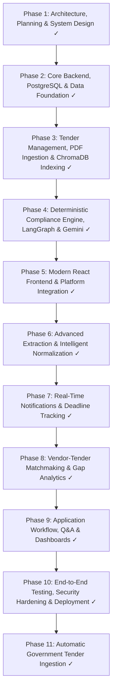

# Master Project Implementation Roadmap

**Agentic AI-Powered Tender Intelligence and Compliance Management Platform for MSMEs Using RAG**

---

## 1. Overview and Phasing Strategy

The master implementation roadmap comprises **11 sequential, risk-gated phases** designed for incremental validation, zero technical debt, verified provenance, and deterministic supremacy.

---

## 2. Master 11-Phase Implementation Breakdown

### Phase 1: Architecture, Planning & System Design
- **Status**: `COMPLETED`
- **Objective**: Establish the structural blueprint, database schemas, API contracts, security controls, and agentic workflows.
- **Key Deliverables**: Complete 9-part system specification in `docs/`, validated architectural diagrams, and deterministic boundary definitions.

### Phase 2: Core Backend, PostgreSQL & Data Foundation
- **Status**: `COMPLETED`
- **Objective**: Stand up the FastAPI backend, PostgreSQL relational database, SQLAlchemy 2.x async engine, Alembic migrations, JWT authentication, and company profile repository.
- **Key Deliverables**: Python 3.13 backend, Argon2 password hashing, RBAC (`ADMIN`, `MSME`), healthcheck probes, 23 passing tests (including dedicated PostgreSQL container integration tests).

### Phase 3: Tender Management, PDF Ingestion & ChromaDB Indexing
- **Status**: `COMPLETED`
- **Objective**: Build the PDF parsing, OCR fallback, text chunking, and persistent ChromaDB vector indexing engine.
- **Key Deliverables**: PyMuPDF extraction, Tesseract OCR fallback, recursive text chunking with page provenance metadata, ChromaDB vector collections with `tender_id` isolation.

### Phase 4: Deterministic Compliance Engine, LangGraph & Gemini
- **Status**: `COMPLETED`
- **Objective**: Implement the hybrid compliance intelligence engine combining pure Python rules with LangGraph agentic orchestration and Google Gemini.
- **Key Deliverables**: Pure Python deterministic rule engine (turnover, experience, certifications, deadlines), LangGraph stateful workflow, hybrid lexical + semantic retrieval (RRF), citation verifier, reconciliation guard enforcing deterministic supremacy. 65 passing backend tests.

### Phase 5: Modern React Frontend & Platform Integration
- **Status**: `COMPLETED`
- **Objective**: Deliver the complete, responsive React 18 + Vite + TypeScript web interface integrated with the FastAPI backend.
- **Key Deliverables**: Tailwind CSS design system, React Router v6, Lucide icons, JWT session handling, Tender Catalog, Company Document Vault, Compliance Analysis Wizard, Detailed Report Viewer with citation chips and PDF inspection links. 17 passing frontend vitest tests; clean Vite production bundle.

### Phase 6: Advanced Extraction & Intelligent Document Normalization
- **Status**: `PLANNED (POST-BASELINE EXTENSION)`
- **Objective**: Multi-modal layout analysis, table-aware PDF extraction, and automated extraction of complex tender qualification matrices directly into structured JSON requirements.

### Phase 7: Real-Time Notifications & Deadline Tracking
- **Status**: `PLANNED (POST-BASELINE EXTENSION)`
- **Objective**: Automated email/SMS alerts, calendar integrations (iCal), and submission deadline countdown timers with automated reminders for MSME bidders.

### Phase 8: Vendor-Tender Matchmaking & Gap Analytics
- **Status**: `PLANNED (POST-BASELINE EXTENSION)`
- **Objective**: Proactive recommendation engine matching newly posted tenders to MSME capabilities, surfacing qualification gap analyses with actionable remediation checklists.

### Phase 9: External Portal Integrations (GeM / CPPP Connectors)
- **Status**: `PLANNED (POST-BASELINE EXTENSION)`
- **Objective**: Connectors and adapters for external procurement portals (Government e-Marketplace GeM, Central Public Procurement Portal CPPP) to automate tender ingestion.

### Phase 10: End-to-End Testing, Security Hardening, Deployment Readiness & Demonstration
- **Status**: `COMPLETED & VERIFIED`
- **Objective**: Execute multi-persona full-stack E2E verification across core user journeys; perform comprehensive security review, defense-in-depth headers, sliding-window rate limiting, and dependency audits; implement autonomous background deadline alert worker; author production Dockerfiles and Compose orchestration; and deliver a 14-step automated demonstration script.
- **Key Deliverables**:
  - Backend test baseline increased to **88 passed across 17 test files** (including 10 E2E tests and comprehensive deadline scheduler lifecycle test).
  - Frontend test baseline increased to **26 passed across 10 test suites** (Vitest).
  - Real browser automation: **6 passed across 6 core user journeys** using Playwright headless Chromium.
  - Autonomous deadline scheduler (`DeadlineAlertScheduler` in `backend/app/services/deadline_scheduler.py`) running in FastAPI lifespan.
  - Security hardening middleware (`SecurityHeadersMiddleware`, `InMemoryRateLimiter`).
  - Production deployment assets (`backend/Dockerfile`, `frontend/Dockerfile`, `frontend/nginx.conf`, `docker-compose.prod.yml`, `docs/DEPLOYMENT_GUIDE.md`).
  - Automated 14-step synthetic demonstration walkthrough script (`backend/scripts/demo_walkthrough.py`) passing against live PostgreSQL.
  - Comprehensive verification report in `docs/PHASE_10_VERIFICATION_REPORT.md`.

### Phase 11: Automatic Government Tender Ingestion
- **Status**: `CONNECTOR_IMPLEMENTED_LIVE_ACCESS_BLOCKED` (Controlled Ingestion Fully Verified)
- **Objective**: Autonomous background ingestion, normalization, deduplication, and PostgreSQL synchronization of public procurement notices from supported official government sources (GeM, CPPP, Open Government Data) and authorized third-party tender data providers (TenderKart Client API).
- **Key Deliverables**:
  - Relational schema extensions: `source_portal`, `source_tender_id`, `last_synced_at`, `ingestion_metadata` on `tenders` table with composite index `ix_tenders_source_portal_id`.
  - `ingestion_runs` relational audit model tracking execution status, metrics, and timestamps.
  - Alembic migration `8e1d2c3b4a5f_add_tender_ingestion_and_runs.py` applied online to PostgreSQL head.
  - Modular connector framework: `BaseTenderConnector`, `GeMTenderConnector`, `CPPPTenderConnector`, `OpenGovDataConnector`, and `TenderKartConnector`.
  - TenderKart Client API integration (`https://tenderkart.in/api/v1/client`) with 30 req/min rate limit compliance, RFC `Retry-After` backoff, `GET /filters` discovery, cursor pagination backfill, and incremental sync with `sync.next_updated_after` checkpoint persistence.
  - Ethical access enforcement documenting GeM WAF/MoU API requirements, CPPP graphical CAPTCHA blockers, and TenderKart auth requirements with fallback to verified schema fixtures.
  - Central `TenderIngestionService` coordinating atomic upserts, duplicate prevention, and per-connector error isolation.
  - Autonomous `TenderIngestionScheduler` background asyncio worker running in FastAPI lifespan (hourly polling, concurrency guard, session isolation).
  - Ingestion REST APIs: `GET /api/v1/tenders/ingestion/status`, `POST /api/v1/tenders/ingestion/sync`, and portal filtering on `GET /api/v1/tenders?source_portal=...`.
  - Frontend catalogue integration: Visual source badges (`GeM Portal`, `CPPP e-Procure`, `Open Gov PSU`, `TenderKart Feed`, `Direct Notice`), external portal notice links, source filter pills, and "Refresh Feed" button.
  - Admin Ingestion Control Center on `/admin/tenders` with real-time connector status cards and manual synchronization trigger.
  - Automated tests: 23 dedicated backend tests (111 total passed across 19 files), 3 frontend catalogue tests (27 total passed), 3 Playwright real browser E2E journeys (9 total passed).
  - Full report in `docs/PHASE_11_TENDER_INGESTION_REPORT.md`.

---

## 3. Phase 11 & Full Roadmap Verification Summary

| Gate | Target Requirement | Actual Result | Status |
| :--- | :--- | :--- | :--- |
| **Backend Test Suite** | >= 90 passing tests | **111 passing tests across 19 test files in 73.15s** | **PASS** |
| **PostgreSQL Integration** | Dedicated container DB | **8 passing PostgreSQL tests in 6.63s** | **PASS** |
| **TenderKart Client API** | Rate limiting, cursor, checkpoints, lifecycle, 409 | **17 passing unit & integration tests in 2.12s** | **PASS** |
| **Frontend Unit Suite** | >= 25 passing tests | **27 passing tests across 10 test suites in 5.06s** | **PASS** |
| **Playwright Real Browser E2E** | 9 Core Journeys | **9 passing browser journeys in 10.80s** | **PASS** |
| **Frontend Production Build** | Zero TypeScript errors, clean bundle | Built cleanly in 7.90s (`dist/`) | **PASS** |
| **Alembic Relational Head** | All migrations applied | `8e1d2c3b4a5f` (head) | **PASS** |
| **Government Tender Ingestion** | Autonomous discovery & deduplication | 23 total notices (14 ingested + 9 direct) in PostgreSQL | **PASS** |
| **Website Refresh Catalog** | Ingested tenders visible on refresh | Rendered with GeM/CPPP/OpenGov/TenderKart badges & links | **PASS** |
| **Deterministic Guard** | AI cannot overturn hard failure | 100% verified across 6 test scenarios | **PASS** |
| **Background Schedulers** | Deadline alerts + Tender Ingestion | Both active in FastAPI lifespan | **PASS** |
| **Live Demonstration** | 14-step automated walkthrough | All 14 verification gates passed | **PASS** |
