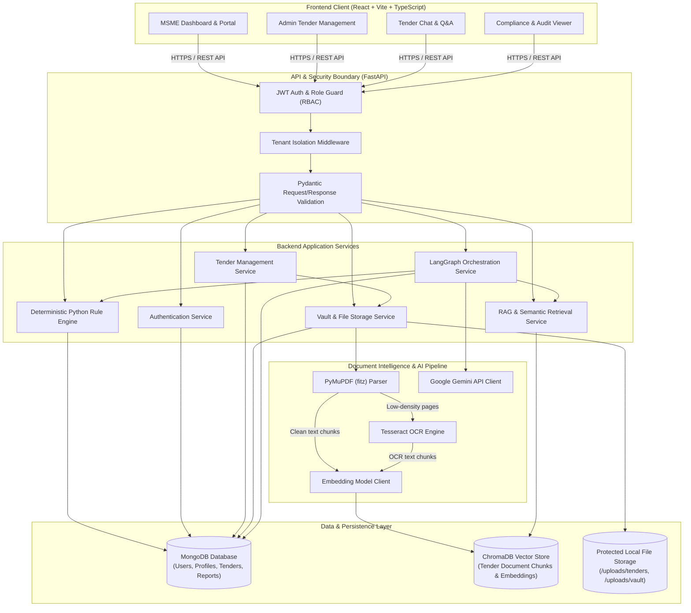
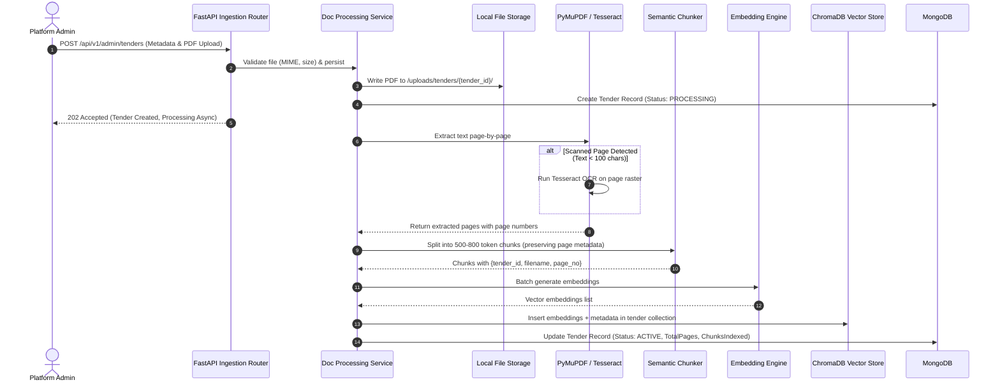
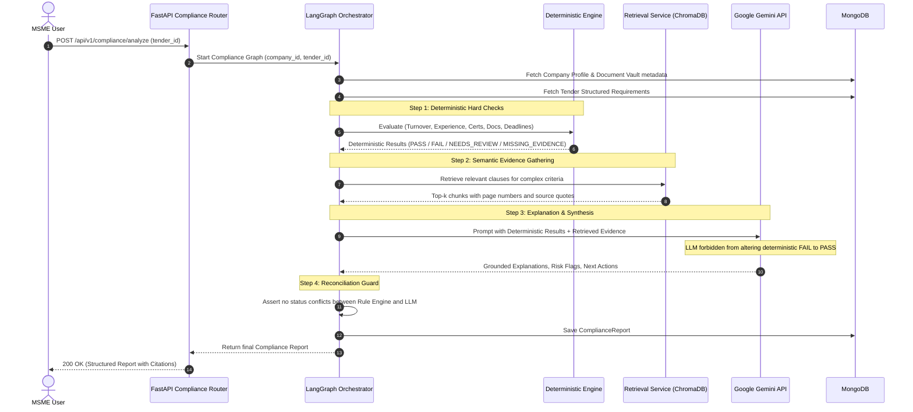
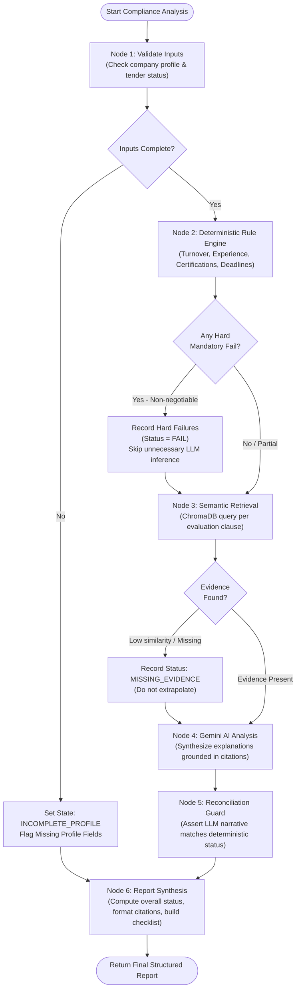

# System Architecture Specification

## 1. High-Level Architecture Overview

The **Tender Intelligence & Compliance Management Platform** follows a modern, decoupled three-tier architecture augmented by an asynchronous document intelligence and agentic workflow pipeline. It bridges deterministic business rules with Retrieval-Augmented Generation (RAG) to deliver explainable, audit-proof tender eligibility assessments for MSMEs.

---

## 2. Component Descriptions

### 2.1 Frontend Tier (Client Layer)
- **Framework**: React 18+ with TypeScript, bundled using Vite for rapid builds and optimized production assets.
- **Routing**: React Router v6 implementing role-aware protected route guards (`<ProtectedRoute role="MSME" />` and `<ProtectedRoute role="ADMIN" />`).
- **Styling**: Tailwind CSS providing responsive, accessible, utility-first UI components.
- **State & Networking**: Axios with interceptors for automatic JWT Bearer token attachment, 401 token refresh handling, and global error handling.

### 2.2 API & Security Gateway (FastAPI)
- **Framework**: FastAPI (Python 3.11+), leveraging ASGI asynchronous request handling.
- **Validation**: Pydantic v2 schemas enforcing strict input validation, type safety, and standardized JSON error payloads.
- **Authentication**: JWT (JSON Web Tokens) with short-lived access tokens and refresh tokens.
- **Tenant Isolation**: Backend middleware injecting `company_id` from the decoded JWT into the request state, guaranteeing that data operations are scoped exclusively to the authenticated tenant.

### 2.3 Application & Business Logic Services
- **AuthService**: Handles user registration, password hashing (via `bcrypt`), login verification, and token issuance.
- **TenderService**: Manages tender document lifecycles, metadata indexing, and status transitions.
- **DocService (Document Vault)**: Manages MSME company documents (incorporation certificates, turnover audit sheets, ISO credentials) and tender PDF files. Enforces mime-type validation and isolated disk directory partitioning.
- **Deterministic Rule Engine**: Pure Python business logic module devoid of LLM dependencies. Evaluates objective mathematical and logical conditions (e.g., turnover, operational years, deadline validity, mandatory document availability).
- **RAG & Retrieval Service**: Interfaces with ChromaDB to perform metadata-filtered cosine similarity searches, extracting contextual tender excerpts with precise page numbers.
- **LangGraph Orchestration Service**: Manages multi-step stateful workflows reconciling deterministic outputs with semantic evidence and Google Gemini LLM synthesis.

### 2.4 Document Intelligence & AI Components
- **PyMuPDF (`fitz`)**: High-performance C-backed PDF parsing extracting text, layout information, and page metadata.
- **Tesseract OCR**: Invoked conditionally when PyMuPDF detects image-only or low-density pages (<100 characters), ensuring scanned tenders are not silently dropped.
- **Embedding Model**: Google Text Embedding API (e.g., `text-embedding-004`) or compatible high-dimensional embedding model creating semantic vectors with tender metadata.
- **Google Gemini API**: `gemini-1.5-flash` or `gemini-1.5-pro` accessed over secure HTTPS for qualitative clause summarization, risk identification, and natural language explanations.

### 2.5 Persistence & Storage Tier
- **MongoDB**: Primary document store managing:
  - User accounts and authentication credentials.
  - MSME company profiles and financial metrics.
  - Tender metadata and structured requirements.
  - Document metadata records and verification statuses.
  - Historical compliance reports and application tracking states.
- **ChromaDB**: Lightweight vector database storing chunk embeddings, chunk text, and source metadata (`tender_id`, `filename`, `page_number`, `chunk_id`).
- **Protected File Storage**: Sandboxed local filesystem storage during development (partitioned by `/uploads/tenders/{tender_id}/` and `/uploads/vault/{company_id}/`), designed behind an abstract `StorageProvider` interface for seamless migration to Amazon S3 or Google Cloud Storage in production.

---

## 3. End-to-End Request and Data Flows

### 3.1 Tender Ingestion & Indexing Flow (Admin)

---

### 3.2 Compliance Analysis Flow (MSME User)

---

## 4. Agentic AI Workflow Architecture (LangGraph)

The LangGraph orchestration engine enforces a predictable, resilient workflow where the Large Language Model acts as an interpreter and synthesizer rather than an unconstrained decision-maker.

### 4.1 Node Roles and Invariant Rules
1. **`InputValidation`**: Ensures the MSME company has populated minimum profile fields (turnover history, incorporation year). If essential data is absent, the workflow short-circuits gracefully.
2. **`DeterministicEvaluation`**: Evaluates all hard mathematical constraints. If a tender mandates a \$1,000,000 turnover and the MSME has \$450,000, this node records `FAIL`.
3. **`RetrievalStep`**: Executes targeted queries against the tender's ChromaDB index using criteria keywords. Returns verbatim text, source filenames, and page numbers.
4. **`LLMAnalysis`**: Passes the deterministic results and retrieved text to Google Gemini with strict system instructions: Gemini is instructed to explain *why* criteria passed or failed, highlight ambiguous technical clauses, and suggest remedial actions.
5. **`ReconciliationGuard`**: A pure Python deterministic safety valve that inspects Gemini's structured output. If Gemini erroneously marks a requirement as satisfied despite a deterministic `FAIL`, the guard overrides the narrative and flags a warning.
6. **`ReportSynthesis`**: Aggregates all criteria into a unified schema, computes the final overall recommendation (`ELIGIBLE`, `INELIGIBLE`, or `POTENTIALLY_ELIGIBLE_WITH_CONDITIONS`), and persists the report to MongoDB.

---

## 5. Error Handling & Service Boundaries

| Service Boundary | Failure Mode | Mitigation & System Behavior |
| :--- | :--- | :--- |
| **Document Processing** | Corrupted or password-locked PDF | Parsing stops immediately; sets tender status to `FAILED_PROCESSING`; logs exact error in MongoDB; notifies Admin UI. |
| **Document Processing** | Scanned PDF with unreadable text | Triggers Tesseract OCR; if OCR confidence < 30%, flags page as `DEGRADED_TEXT_QUALITY` but continues remaining pages. |
| **ChromaDB Vector Store** | Vector index unavailable or corrupt | Fallback to deterministic evaluation only; flags compliance report as `RAG_UNAVAILABLE`; LLM semantic check marked `NEEDS_REVIEW`. |
| **Google Gemini API** | Rate limit (429) or Service Down (503) | Exponential backoff retry (up to 3 attempts); if still unavailable, report returns deterministic results with raw retrieved excerpts without AI summary. |
| **Deterministic Rule Engine** | Missing company profile field | Marks specific criterion as `MISSING_EVIDENCE` instead of crashing; overall status reflects missing prerequisites. |
| **Tenant Isolation Guard** | Attempted cross-tenant ID access | Request immediately rejected with HTTP 403 Forbidden; audit event logged to application security logs. |
