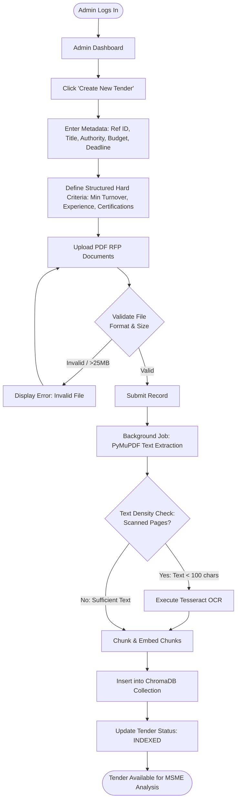
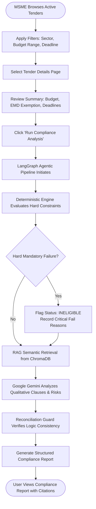
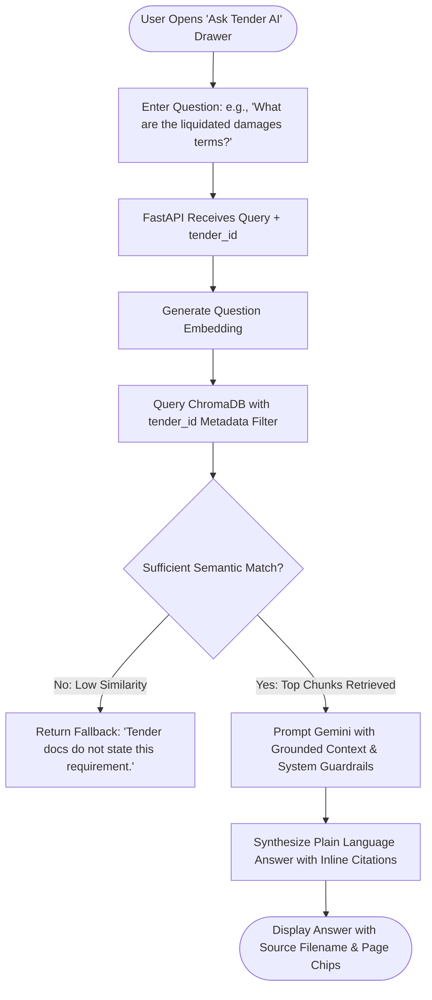
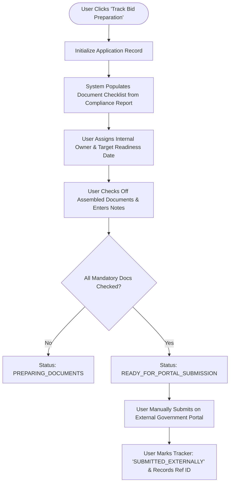

# User Flows and Interaction Journeys

## 1. Overview of Platform Journeys

The platform supports two distinct user roles:
1. **Platform Administrator**: Curates tender notices, uploads RFP documents, monitors extraction/OCR pipelines, and oversees processing health.
2. **MSME Company User**: Manages company credentials in the Document Vault, searches tenders, triggers compliance evaluations, asks grounded clause questions, and tracks bid preparation.

---

## 2. Administrator Journey: Tender Management & Ingestion



### Detailed Flow Steps:
1. **Authentication**: Admin signs in using administrator credentials.
2. **Tender Initialization**: Admin fills in key tender parameters including title, procuring agency, estimated contract value, EMD amount, and hard closing deadline.
3. **Structured Criteria Definition**: Admin inputs baseline numerical rules (e.g., minimum turnover of \$500k, minimum 3 years of operational experience, ISO 9001 mandatory).
4. **Document Attachment**: Admin uploads the official PDF documentation (RFP, technical specifications, terms & conditions).
5. **Asynchronous Processing**: The system ingests files, classifies pages, applies OCR to rasterized pages, and builds persistent ChromaDB vector collections.
6. **Verification State**: Admin monitors the Ingestion Status badge (`PENDING` -> `EXTRACTING` -> `INDEXED`).

---

## 3. MSME User Journey: Registration & Profile Setup

```mermaid
flowchart TD
    M1([MSME Lands on Site]) --> M2[Sign Up: Email, Password, Company Legal Name, Tax ID]
    M2 --> M3[System Creates User & Company Tenant Record]
    M3 --> M4[Redirect to Company Setup Wizard]
    M4 --> M5[Step 1: Enter Business Sector, Incorporation Date]
    M5 --> M6[Step 2: Enter Audited Annual Turnover for Past 3 FYs]
    M6 --> M7[Step 3: Document Vault Upload\n(Upload Balance Sheets, MSME Reg, ISO Certs)]
    M7 --> M8{Files Validated?}
    M8 -->|Fail| M9[Show Warning: Non-PDF or Corrupt File] --> M7
    M8 -->|Pass| M10[Compute System Readiness Score]
    M10 --> M11([MSME Profile Active - Navigate to Tender Discovery])
```

### Key Setup Elements:
- **Baseline Data Entry**: Incorporation date (used for auto-calculating operational experience), registered business type (Micro, Small, Medium), and audited revenue.
- **Document Vault Ingestion**: Uploading proof documents into their isolated tenant vault. The platform calculates a "Profile Readiness Score" reflecting document coverage.

---

## 4. MSME User Journey: Tender Discovery & Compliance Evaluation



### Evaluation Presentation:
- **Clear Status Badge**: `ELIGIBLE` (Green), `POTENTIALLY_ELIGIBLE_WITH_CONDITIONS` (Amber), `INELIGIBLE` (Red).
- **Rule-by-Rule Breakdown**: Displays company credential vs. required threshold, evaluator engine (Deterministic vs. RAG), and pass/fail badge.
- **Auditable Citations**: Each finding features an expandable citation card showing the source PDF filename, page number, and exact quoted clause.
- **Missing Document Alerts**: Specific callouts for required documents not present in the MSME's vault.

---

## 5. MSME User Journey: Contextual Tender Q&A



### Guardrail Behaviors:
- If an MSME asks a question unrelated to the tender (e.g., general programming or cooking), the model politely declines and steers back to the tender.
- If a clause is absent from the uploaded documents, the model does not guess or interpolate; it explicitly reports that the specification is silent on that matter.

---

## 6. MSME User Journey: Internal Application Preparation & Tracking



---

## 7. Empty States, Edge Cases & Error Scenarios

### 7.1 Empty States
1. **No Tenders Found**:
   - **Trigger**: Search query or sector filter yields 0 matches.
   - **UI Presentation**: Friendly illustration with prompt: "No active tenders match your filters. Try clearing filters or check back soon."
2. **Empty Document Vault**:
   - **Trigger**: New MSME user has not uploaded any credentials.
   - **UI Presentation**: Prompt highlighting benefits: "Upload your Balance Sheets and Certifications to enable one-click eligibility evaluations."
3. **No Compliance Analysis Run Yet**:
   - **Trigger**: MSME views tender details for the first time.
   - **UI Presentation**: Action card: "Run your free AI compliance evaluation to verify eligibility and discover missing documents."

### 7.2 Error Scenarios & Recoveries
1. **Expired Tender Notice**:
   - **Condition**: User clicks "Run Analysis" on a tender whose `submission_deadline` is in the past.
   - **Behavior**: System performs analysis but displays a permanent alert banner: "This tender expired on [Date]. Analysis is generated for historical reference only."
2. **Corrupted or Password-Protected PDF**:
   - **Condition**: Admin uploads a password-locked or damaged PDF.
   - **Behavior**: Ingestion fails immediately with a descriptive error: "Unable to parse [filename]: File is password protected. Please unlock and re-upload."
3. **Gemini API Transient Failure**:
   - **Condition**: Gemini API experiences 503 or quota throttling.
   - **Behavior**: UI gracefully displays the complete deterministic report with the notice: "AI summary unavailable due to upstream connectivity. Deterministic compliance results and raw clause citations are displayed below."
